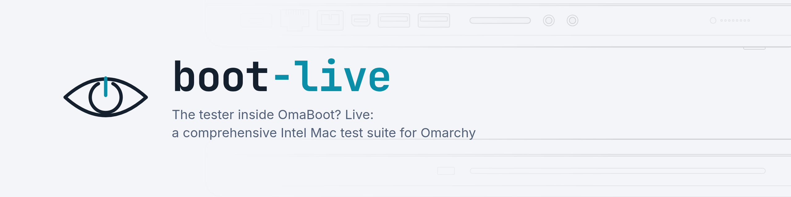
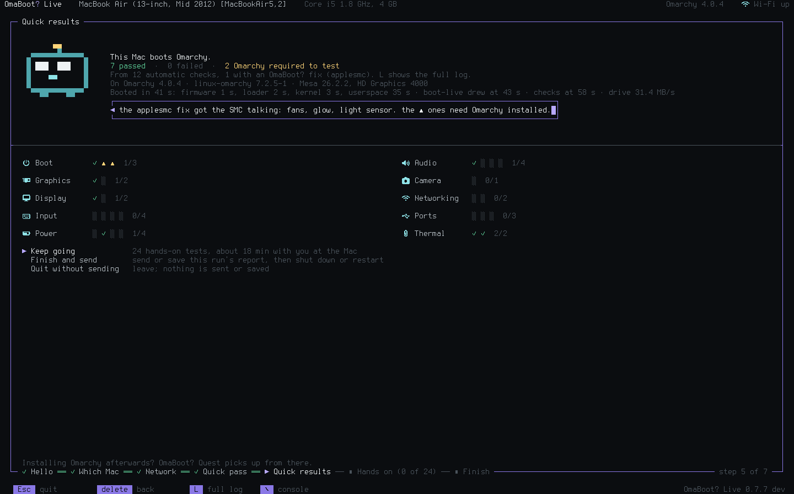
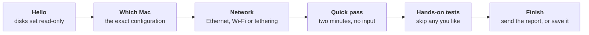
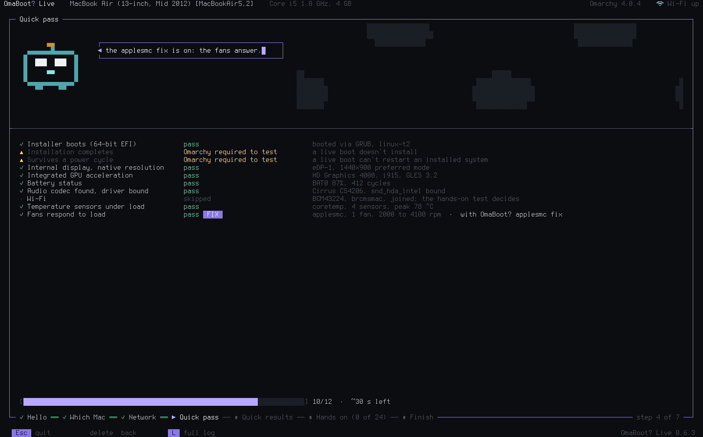
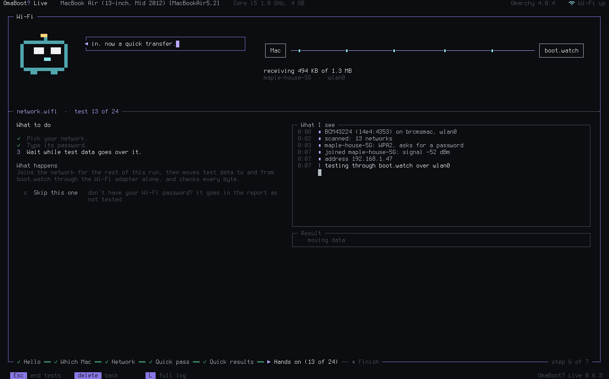
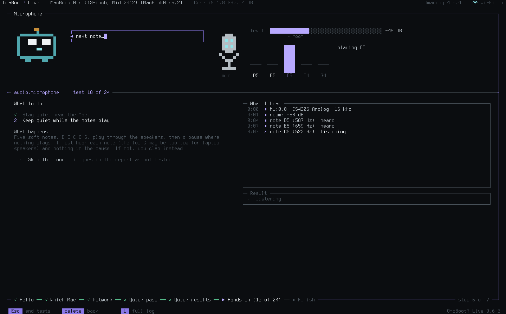
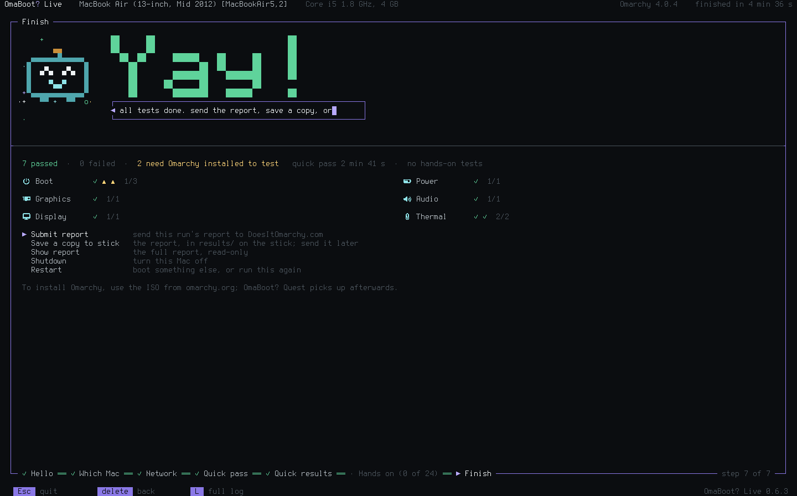
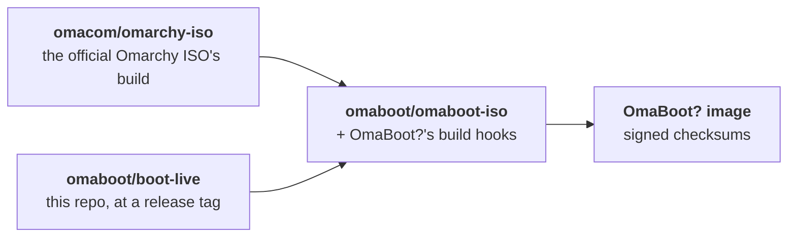
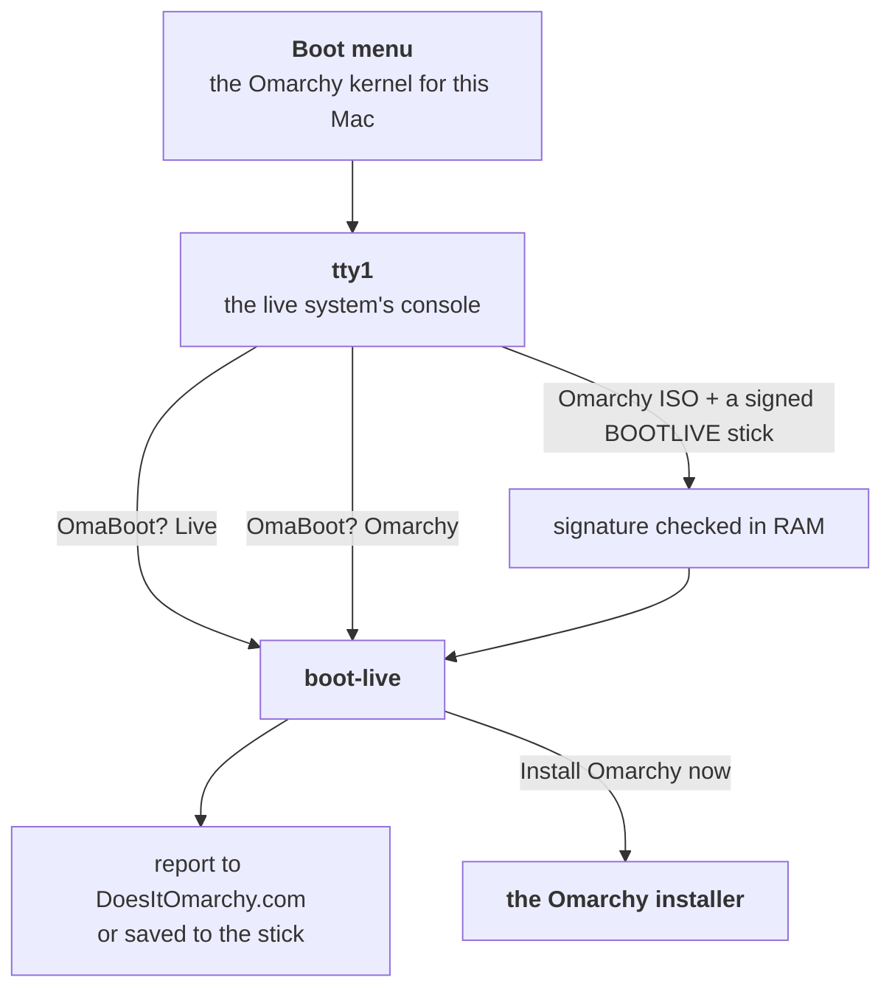

<p align="center">
  <picture>
    <source media="(prefers-color-scheme: dark)" srcset=".github/assets/header-dark.png">
    
  </picture>
</p>

# boot-live

**Will [Omarchy](https://omarchy.org) run on this Mac?** boot-live answers that on the Mac itself.
It is the tester inside [OmaBoot? Live](https://omaboot.live): boot an Intel Mac (2006–2020) from
a USB stick, and boot-live works out exactly which Mac it is, tests the hardware under the real
Omarchy kernel and drivers, and sends the results to [DoesItOmarchy.com](https://doesitomarchy.com),
where everyone with the same Mac can see what to expect.

It runs on the Mac's bare Linux console, guided by Boot, a small character who explains what's
happening, and it never touches the Mac's disks.

<p align="center">
  <picture>
    <source media="(prefers-reduced-motion: no-preference)" srcset=".github/assets/screens/hero-quick-pass.webp">
    
  </picture>
</p>

## What a run looks like



- **Which Mac.** One model identifier can hide several Macs: a MacBookPro8,2 shipped with three
  graphics chips. boot-live reads the board ID and the chips' IDs and picks the one matching
  configuration from DoesItOmarchy.com's catalog, built in so it works offline.
- **Quick pass.** No input, about two minutes: the boot path, graphics, the display, the battery,
  the sound chip, temperatures under load and the fans.
- **Hands-on tests.** The ones that need you: keyboard and trackpad, speakers and microphone,
  camera, Bluetooth, Wi-Fi and Ethernet (real data to [boot.watch](https://omaboot.live/docs/#bootwatch)
  and back, every byte checked), external display, headphones, USB, SD card, Thunderbolt,
  FireWire, the optical drive, the lid, sleep and wake. Each one is offered only on the Macs that
  have the hardware.
- **Finish.** One report per run, sent to DoesItOmarchy.com, or saved to the stick when there's
  no network.

| | |
|---|---|
|  |  |
| **Quick pass.** Graphics, display, battery, sound chip, temperatures and fans. | **Wi-Fi.** Real data to boot.watch and back, every byte checked. |
|  |  |
| **Microphone.** The Mac plays five notes and has to hear them back. | **Finish.** Send the report, or save a copy to the stick. |

## Safe by design

- **Your disks stay untouched.** Before anything else, every internal disk is set read-only and
  checked. Nothing is installed, and nothing writes to NVRAM, EFI variables, the SMC or firmware.
  Pull the stick and the Mac is as it was.
- **It runs only where it should.** Outside the OmaBoot? live system boot-live refuses to start.
- **A thermal watchdog** stops any load before a sensor gets near its critical temperature.
- **Private by default.** Serial numbers, MAC addresses and host names are never read. The report
  holds the hardware IDs, the results and the name you choose to be credited with; you see it
  before it goes. See [what gets sent](https://omaboot.live/privacy/).

## How it fits into Omarchy's ISO

boot-live doesn't replace the Omarchy installer; it rides along with it. The images are built by
[omaboot/omaboot-iso](https://github.com/omaboot/omaboot-iso), a fork of Omarchy's own
[omarchy-iso](https://github.com/omacom/omarchy-iso): every package is the official Omarchy ISO's
own file, and each release lists exactly what differs.



The build adds a static boot-live binary and its fonts under `/usr/share/omaboot/`, compiles its
small GPU probe against the image's own Mesa, writes where reports go (`target.conf`), and hooks
boot-live into the live system's first console. On the Mac:



| Edition | What it is |
|---|---|
| **OmaBoot? Live** | A stripped-down omarchy-iso with just the essentials and boot-live, which starts instead of the installer. About 1.2 GB; runs on Macs with 2 GB of RAM. |
| **OmaBoot? Omarchy** *(coming)* | The full Omarchy installer plus boot-live: test first, then "Install Omarchy now" hands over to the installer on the same stick. |
| **OmaBoot? Slim** *(coming)* | The official Omarchy ISO on one stick, boot-live on a second (labelled `BOOTLIVE`, signed): the ISO checks the signature and runs it before the installer. |

Downloads, checksums and how to verify them: [omaboot.live](https://omaboot.live/download/).

## Try it without a Mac

Needs Go 1.27 and a terminal of at least 120×40 characters.

```sh
make demo                                   # a scripted run on a MacBook Air, made-up results
./dist/boot-live --sysroot testdata/imac10,1 --term --stick /tmp/stick
                                            # the real run, reading a recorded iMac's hardware; writes nothing
```

Keys: ↑↓ choose, Enter go, Esc quit (it asks first), Backspace back a step, **L** the full log.
On a test, each answer shows its number. **`** opens the [console](https://omaboot.live/docs/console/).

## Build

```sh
make build     # dist/boot-live, a static binary
make helper    # dist/egl-probe, the GPU probe (needs Mesa's headers)
make check     # vet, tests, translations, formatting, scrub check
```

Contributing or working on it with an agent: [AGENTS.md](AGENTS.md).

## Licence

Code: MIT ([LICENSE](LICENSE)), © The OmaBoot? authors. Font: omaboot-v, a modified Terminus Font,
SIL Open Font License 1.1 ([assets/fonts/OFL.txt](assets/fonts/OFL.txt),
[NOTICE](assets/fonts/NOTICE)).
